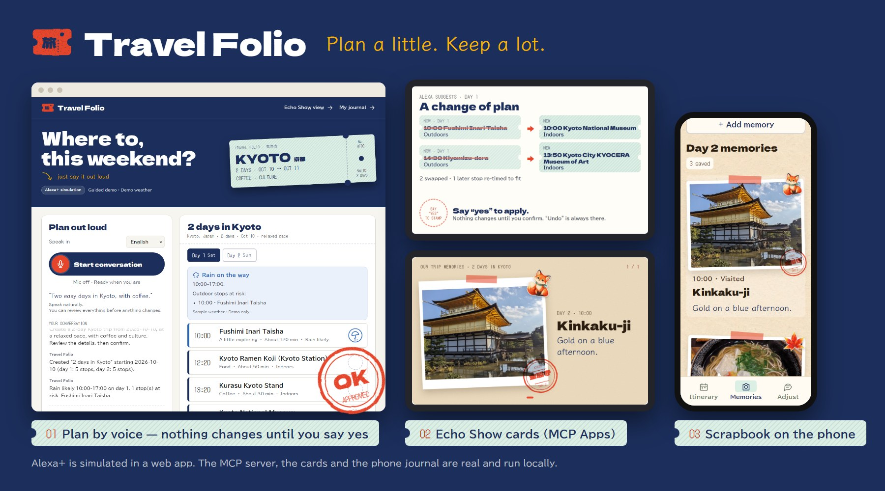

# Travel Folio



**Plan a little. Keep a lot.** Plan a trip at home, take it to your phone, turn the
same itinerary into a scrapbook with photos, words and 32 travel stickers, then relive
it together on the (simulated) Echo Show.

This is a **simulated Alexa+ experience** with a working self-hosted MCP backend.
The default uses a small guided conversation engine and clearly labelled sample
weather. No AWS account, model key, build step, or external font is needed to try it.

## Design

The look is called **kippu & stamp** (切符とスタンプ): a trip starts as a ticket, the phone
journal is a stamp rally, and the memories become a stamp book. Indigo and vermilion,
station-style ink stamps, a departure board on the Echo Show, and approving a change
literally stamps it "OK". Photos are pasted on light kraft paper with colourful stickers.
Type: Dela Gothic One (headings), DotGothic16 (times, ticket print), BIZ UDPGothic (body
text, a universal-design face chosen for older readers) and Klee One (handwritten captions).
All fonts are small local subsets under the SIL Open Font License (see `public/fonts/`).

## Run

Node.js 22 or newer:

```sh
npm ci
npm start
```

Open <http://127.0.0.1:4317>. For Windows, the parent folder's
`Start Travel Folio.cmd` also starts the demo and opens a browser after dependencies
have been installed. Keep the terminal open; Ctrl+C stops the server.

Open **Choose the details yourself**, then choose Kyoto, two days and a relaxed
pace. Review the creation proposal and confirm. **Type instead** opens text chat.
Check the sample weather, propose an indoor swap, review the changes and confirm.
Use **Take to my phone** to open the real itinerary in the phone journal.
Add photos and memories, then use **Save & take → Keep the whole journal** to export
a standalone HTML copy.

**Print** opens an A4 paper preview: itinerary, memories, or both. Choose all days
or one day. A compact trip fits one sheet; longer content continues onto additional
pages without dropping notes, captions, photos or stickers. The preview reports
the page count. This layout also works in exported standalone journals.

## Relive the trip on Echo Show

After the trip, open **Save & take → Show memories on Echo Show** in the phone journal.
This appears only in a journal opened from this home's QR link (the link pairs the phone
with the home). The phone asks first, then sends photos, captions and stickers to this
computer over the local network. Private trip notes, packing lists and planning notes are
never sent. At home, Travel Folio greets you ("3 memories from your phone just arrived")
and **Show our memories** (or 「思い出を見せて」) plays them as a slideshow card on the
Echo Show view. Sharing again replaces the set; saved sets live in `data/homes/`.

## Open it on a phone

Stop the localhost server and run:

```sh
npm run share
```

The Windows shortcut `Start Travel Folio - Phone.cmd` does the same thing.
This deliberately listens on the local network and chooses a LAN address for the QR.
Use the same trusted Wi-Fi on the PC and phone, keep the server running, and allow
the app on that private network if your firewall asks. VPN adapters or guest Wi-Fi
can prevent access. If the wrong adapter was chosen, set `PUBLIC_BASE_URL` to the
actual LAN origin, for example `http://192.168.1.20:4317` (replace that address).

The ordinary localhost launch gives a working link for this computer, and explains
why that link cannot be scanned from a different phone. No public hosting is created.

## Plan out loud

Choose **English** or **日本語**, press **Start conversation**, and allow the
microphone. Once started, final utterances send automatically, responses are read
aloud, and listening resumes when the reply finishes. For example:

> “Plan two easy days in Kyoto, with coffee.” → “Yes, use this plan.” →
> “Check weather.” → “Take it to my phone.”

Japanese works too: 「京都に2日間、カフェ多めでゆっくり」→「それでお願い」→
「スマホで開きたい」. Phone handoff shows the link/QR and ends the conversation.
Use the Phone launcher above for a QR reachable on the same Wi-Fi; keep the home
conversation open at `http://127.0.0.1:4317` on the PC.

Voice approval is tied to the exact proposal whose read-aloud finished successfully.
“Yes, but…” does not approve a proposal. An interrupted or outdated reading must
be read again. **End conversation**, “stop”, or 「やめて」 stops listening and
speaking; switching tabs also stops it. A request already sent may still finish.

Voice uses the browser's Web Speech APIs, with limited browser availability and
possible online speech processing. If unavailable, try the same address in Chrome,
or use the form/text controls. See [SpeechRecognition](https://developer.mozilla.org/en-US/docs/Web/API/SpeechRecognition).
No raw audio is sent to this app's backend; recognized text is sent to the local
server (and to Bedrock for model conversation when that mode is explicitly enabled).
The app does not listen before Start, in the background, or while reading a reply.
Actual microphone/voice quality still needs a check on the user's browser.
This does not add an Echo wake-word integration or launch a closed browser by voice.

## Optional live weather and Bedrock

Conversation and weather are independent. To keep guided conversation but use a real
forecast, in PowerShell:

```powershell
$env:WEATHER_MODE = 'live'
npm start
```

To enable cloud conversation, configure your own tool-capable Amazon Bedrock model
or inference profile and AWS access, then set:

```powershell
$env:AGENT_MODE = 'bedrock'
$env:AWS_REGION = 'YOUR_AWS_REGION'
$env:BEDROCK_MODEL_ID = 'YOUR_MODEL_OR_INFERENCE_PROFILE_ID'
npm start
```

Model availability is account/region dependent. The AWS SDK uses its standard
credential provider chain on the server. Never paste credentials into the UI or
commit them. Bedrock requests can incur AWS charges; no real Bedrock request is made
in the default demo or the automated tests. Missing configuration produces an
actionable error; the form and quick-action buttons continue to work.

`.env.example` documents the settings. Node does not load `.env` automatically with
`npm start`; use shell variables or `node --env-file=.env src/server.js`.
The double-click demo launchers and `npm run share` intentionally use guided/demo mode.

## What works

- Guided English/Japanese commands plus a trip form and quick actions. Kyoto and
  Seattle, one to four days, curated places, estimated travel times.
- **Remembers you between visits.** The home plan is saved on this computer. Come
  back later (even after a restart) and Travel Folio speaks first: it checks the
  destination calendar and forecast through MCP, then offers the useful next step,
  e.g. “Rain from 10:00 on day 1 affects Fushimi Inari. Shall I look for indoor
  alternatives?” Saying yes only prepares a proposal; applying it needs its own confirmation.
- Every home trip tool runs through an actual MCP SDK client and Streamable HTTP
  endpoint. The SDK supports MCP 2025-11-25. Expand the activity details to inspect calls.
- **MCP Apps for screens.** Eight trip tools declare a `ui://` view
  (`text/html;profile=mcp-app`, spec 2026-01-26), the extension Alexa+ uses to render
  interactive cards on Echo Show. The view is one self-contained bundle (fonts inlined,
  empty CSP allowlist) that follows the Alexa+ layout foundations: a 768x480 canvas,
  one root zoom per device and large type. Its colours and type are Travel Folio's own design.
  Open **Echo Show view** (top right) to see it: a small MCP Apps host renders the latest
  card through a cross-origin sandbox proxy, the way a web host must, next to the spoken reply.
- New trips and proposed changes wait for the human's exact confirmation. The AI
  tool allowlist cannot apply or undo a change itself.
- Locked and visited stops are protected; stale/expired proposals cannot be applied;
  Undo restores the previous home itinerary.
- Open-Meteo integration or reproducible sample weather, with failures/unknown data
  represented explicitly. Weather-based changes are not made from unavailable forecasts.
- Memories shared back from a paired phone, validated and size-capped, shown by the
  `show_memories` MCP tool as a scrapbook slideshow card. A model in Bedrock mode only
  receives titles and words, never image data.
- Compressed itinerary links and locally generated QR images. Photos, captions,
  stickers, visit status and private notes are excluded from transfers.
- The existing phone journal: manual editing, real browser persistence, photo resizing,
  stickers, import/export and recovery after failed saves.

Opening hours, closures, routes, prices and bookings are not checked. A suggested
itinerary is a starting point to review. Curated catalog data can become outdated.

## Architecture

```text
Home browser → Express conversation controller
                 ├─ guided parser (default) / optional Bedrock Converse
                 └─ MCP SDK HTTP client → /mcp → session TripStore + travel tools
                                                    ├─ weather provider
                                                    └─ link + QR → /phone/#trip=…
Phone browser → IndexedDB / localStorage → standalone HTML or JSON backup
```

`public/show.html` + `show.js` are the simulated Echo Show (an MCP Apps host) and
`public/mcp-app/sandbox.html` its sandbox proxy; `src/mcp/trip-card.html` is the view.
`public/index.html`, `home.css`, `home.js` are the home interface; `voice.js`
controls microphone/read-aloud turns and lifecycle cleanup.
`src/server.js` starts the server; `src/agent/` handles conversation, confirmation,
and the MCP client. `src/mcp/` defines the actual transport and tools.
`src/domain/` contains planning and state logic. `public/phone/index.html` is the
adapted GPT-Pro journal and remains exportable as a single file.

Home sessions are isolated by a random browser cookie. `npm start` and the launchers
save each home plan as JSON in `data/homes/` (set `DATA_DIR` to change it), so it
survives restarts; delete that folder to forget saved plans. A damaged file is never
overwritten. The phone journal is a separate local copy and does not automatically sync. Browser storage can be
cleared by the browser or user: export a backup of memories you want to keep.

The MCP endpoint uses an internal server-generated bearer credential and is bound
to the corresponding browser session. Credentials are not exposed in frontend JS.
Browser mutations reject cross-origin requests. This is a local/LAN demo, not an
internet multi-user service with user accounts or production authentication.

## Verification and submission preparation

Run `npm test`. [TESTING.md](TESTING.md) distinguishes automated checks, browser QA,
and integrations still requiring real devices/accounts. [DEMO.md](docs/DEMO.md)
provides a short walkthrough. [FRICTION_LOG.md](docs/FRICTION_LOG.md) is our developer
friction log for the Alexa+ tools; [DEVELOPMENT_LOG.md](docs/DEVELOPMENT_LOG.md) records our
own implementation findings. [SUBMISSION.md](docs/SUBMISSION.md) holds the Devpost text. The two `legacy-*.md` documents are historical reports, not
instructions for this app.

The [organizer's simulation clarification](https://amazonappdev2026.devpost.com/forum_topics/45058-clarification-on-simulated-alexa-web-experience-requirements)
allows a simulated conversational experience without live model calls or voice.
This implementation also demonstrates real MCP tool calls. See the current
[rules](https://amazonappdev2026.devpost.com/rules) when preparing a submission.
No repository has been published, no contest submission has been sent, and no real
Alexa+ or Echo integration is claimed here.

## Sources and credits

- [Amazon Bedrock Converse API](https://docs.aws.amazon.com/bedrock/latest/APIReference/API_runtime_Converse.html)
- [MCP TypeScript SDK](https://github.com/modelcontextprotocol/typescript-sdk)
- [Open-Meteo forecast documentation](https://open-meteo.com/en/docs); live weather
  data is attributed to Open-Meteo, CC BY 4.0.
- Existing Travel Folio artwork and phone journal supplied by the user. The phone
  QR encoder's BSD/MIT copyright notices remain embedded in the HTML.
- New project code uses MIT; dependencies retain their respective licenses.
